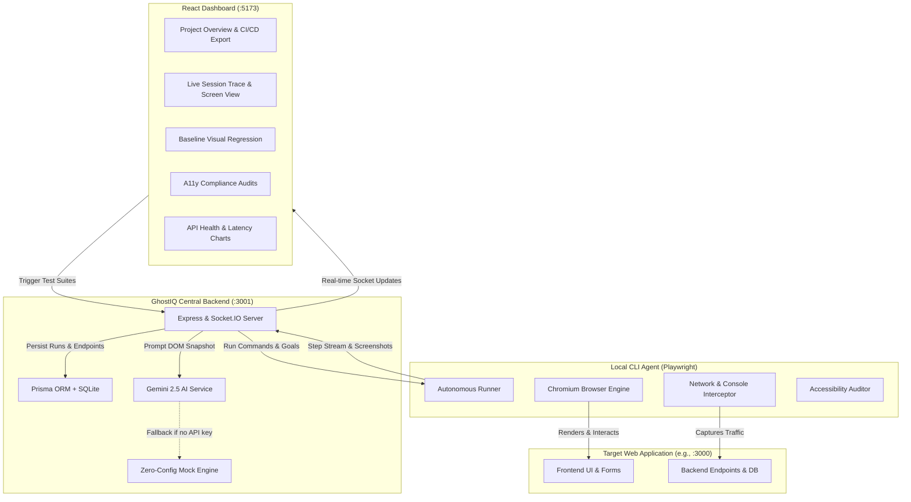

# 👻 GhostIQ — Autonomous AI QA Engineer & Self-Healing Testing Platform

[](https://www.typescriptlang.org/)
[](https://playwright.dev/)
[](https://deepmind.google/technologies/gemini/)
[](https://www.prisma.io/)
[](https://reactjs.org/)
[](https://vitejs.dev/)

**GhostIQ** is an autonomous quality assurance (QA) platform powered by Google Gemini and Playwright. Unlike traditional testing frameworks that depend on brittle pre-written test scripts and static element locators, GhostIQ deploys **autonomous AI testing agents** that navigate web applications using real-world user personas, dynamically heal broken DOM selectors on the fly, monitor API health in real time, audit accessibility compliance, and diagnose root-cause failures with actionable fixes.

---

## 📑 Table of Contents

- [Core Features](#-core-features)
- [System Architecture](#-system-architecture)
- [Current Implementation Status](#-current-implementation-status)
- [Repository Structure](#-repository-structure)
- [Prerequisites](#-prerequisites)
- [Quick Start Guide](#-quick-start-guide)
  - [1. Start the Mock Target Application](#1-start-the-mock-target-application)
  - [2. Start the GhostIQ Central Backend](#2-start-the-ghostiq-central-backend)
  - [3. Start the Web Dashboard](#3-start-the-web-dashboard)
  - [4. Launch the Local CLI Test Agent](#4-launch-the-local-cli-test-agent)
- [AI Testing Personas](#-ai-testing-personas)
- [API Health & Network Telemetry](#-api-health--network-telemetry)
- [Visual Regression & Accessibility Auditing](#-visual-regression--accessibility-auditing)
- [Self-Healing Engine](#-self-healing-engine)
- [Environment Variables & Configuration](#-environment-variables--configuration)
- [Roadmap](#-roadmap)

---

## 🌟 Core Features

### 1. 🤖 Persona-Driven Autonomous Testing
Instead of linear assertion scripts, GhostIQ passes the page DOM accessibility tree, history, and goals to **Gemini 2.5 Flash** to simulate realistic user personas:
- **Happy Path User**: Methodical, enters valid credentials, waits for animations, verifies expected workflows.
- **Chaotic Explorer**: Rapid clicks, checks unlinked routes, interacts with non-standard controls, exposes race conditions.
- **Form Stress Tester**: Submits empty fields, boundary conditions, malformed emails, and invalid input strings to stress-test client/server validation.

### 2. 🩹 Dynamic Self-Healing Selectors
When frontend redesigns or dynamic class/ID updates cause a selector to fail or time out, the agent captures the interactive DOM snapshot and asks the AI selector healer to map the intended action to the updated element, continuing test execution without human intervention.

### 3. ⚡ Real-Time WebSocket Streaming & Live View
- Bi-directional Socket.IO communication between the browser runner, central server, and React dashboard.
- Live streaming of step descriptions, pass/fail status, execution time, and rendered browser screenshots.
- Sticky live preview displaying the actual browser state on the runner machine.

### 4. 🌐 API Endpoint Telemetry & Health Tracking
- Automatically intercepts all `fetch` and `xhr` calls during Playwright execution.
- Measures latency per request and tracks endpoint health across test sessions.
- Visualizes route latencies and highlights degraded/failing endpoints (4xx/5xx status) via interactive charts.

### 5. ♿ In-Session Accessibility (a11y) Auditing
- Scans rendered DOM elements on each step for common accessibility defects:
  - Missing image `alt` attributes.
  - Inputs missing associated labels, placeholders, or `aria-label` attributes.
  - Interactive buttons without accessible names or text descriptors.
- Categorizes issues by severity (*Critical*, *Serious*, *Moderate*) with exact HTML snippets.

### 6. 👁️ Visual Regression vs. Project Baseline
- Mark any successful test run as the **Project Baseline**.
- Future test runs display side-by-side snapshot comparisons step-by-step to quickly detect layout drift or rendering glitches.

### 7. 🔍 Gemini AI Root-Cause Bug Diagnostics
When a test session fails, Gemini analyzes:
- The full step history and target selectors.
- Network calls with status codes and latencies.
- Browser console error and uncaught exception traces.
- Generates an executive summary, point-of-failure analysis, and recommended code fixes.

### 8. 🛡️ Zero-Config Smart Mock Fallback
No Gemini API key? GhostIQ includes a built-in state-machine mock engine that produces realistic actions, selector healing, and diagnostics reports out of the box for instant evaluation.

---

## 🏗️ System Architecture



---

## 📊 Current Implementation Status

| Component | Feature | Status | Notes |
| :--- | :--- | :---: | :--- |
| **Backend** | Express + Socket.IO Server | ✅ Complete | Real-time agent registration, session orchestration, screenshot storage. |
| **Backend** | Prisma ORM & Database | ✅ Complete | SQLite schema tracking Projects, Sessions, Steps, Network Requests, and Endpoint Health. |
| **Backend** | Gemini 2.5 Flash Integration | ✅ Complete | `@google/genai` implementation for step planning, selector healing, and diagnostics. |
| **Backend** | Offline Mock Engine | ✅ Complete | Enables instant evaluation without a Gemini API key. |
| **Backend** | Flakiness Score Calculator | ✅ Complete | Measures transition frequency between passed/failed runs across identical configurations. |
| **Backend** | CI/CD PR Export Endpoint | ✅ Complete | Generates GitHub PR review comment summaries ready for CI pipeline integration. |
| **CLI Agent** | Playwright Automation Runner | ✅ Complete | Headless Chromium runner with configurable viewport and step loops. |
| **CLI Agent** | Network Traffic Interception | ✅ Complete | Traces fetch/XHR latencies, HTTP status codes, and endpoint paths. |
| **CLI Agent** | Console Log & Crash Capture | ✅ Complete | Intercepts `console.error`, `console.warn`, and uncaught exceptions. |
| **CLI Agent** | Self-Healing Selector Engine | ✅ Complete | Detects locator timeouts, queries AI healer, and retries seamlessly. |
| **CLI Agent** | Automated a11y DOM Audits | ✅ Complete | Identifies missing alt tags, unlabelled inputs, and empty button descriptors. |
| **Dashboard** | Glassmorphism UI & Navigation | ✅ Complete | Dark-mode HSL design system built with Vite + React 18. |
| **Dashboard** | Real-Time Step Trace | ✅ Complete | Collapsible step timeline, selector badges, error callouts, and network tables. |
| **Dashboard** | Visual Regression Comparison | ✅ Complete | Side-by-side snapshot comparisons against marked project baselines. |
| **Dashboard** | API Health & Latency Analytics | ✅ Complete | Recharts bar charts showing endpoint latencies, call counts, and high-risk flags. |
| **Dashboard** | AI Testing Persona Showcase | ✅ Complete | Detailed overview of persona behavioral traits, pacing, and fill strategies. |
| **Dashboard** | AI Diagnostic Report Viewer | ✅ Complete | In-app Markdown renderer for Gemini root-cause failure reports. |
| **Mock Target App** | Playground Web App | ✅ Complete | Includes intentionally designed validation errors, slow routes, and dynamic DOM IDs. |

---

## 📁 Repository Structure

```
Ghost-IQ-main/
├── backend/                       # Central Orchestration Server & AI Engine
│   ├── prisma/
│   │   └── schema.prisma          # Database schema (Projects, Sessions, Steps, Telemetry)
│   ├── public/screenshots/        # Persisted screenshots captured during test runs
│   ├── src/
│   │   ├── services/
│   │   │   └── ai.ts              # Gemini 2.5 Flash prompt orchestration & mock fallbacks
│   │   ├── seed.ts                # Database seed script for default local project
│   │   └── server.ts              # REST API & Socket.IO telemetry coordinator
│   ├── package.json
│   └── tsconfig.json
│
├── cli-agent/                     # Headless Playwright Test Execution Agent
│   ├── src/
│   │   ├── index.ts               # CLI entrypoint (commander + socket connection)
│   │   └── runner.ts              # Playwright browser runner, self-healing, & a11y checks
│   ├── package.json
│   └── tsconfig.json
│
├── dashboard/                     # React + Vite Web Management Console
│   ├── src/
│   │   ├── components/
│   │   │   ├── DashboardView.tsx  # Overview telemetry, test launcher, & PR exporter
│   │   │   ├── EndpointsView.tsx  # API health & latency metrics (Recharts)
│   │   │   ├── PersonaBuilder.tsx # AI user persona configurations
│   │   │   └── SessionsView.tsx   # Step traces, visual regression, a11y, & AI diagnostics
│   │   ├── App.tsx                # App shell, project switcher, & Socket.IO listener
│   │   ├── index.css              # Custom dark-theme glassmorphism styling
│   │   └── main.tsx
│   ├── package.json
│   └── vite.config.ts
│
├── mock-target-app/               # Sample web app for immediate out-of-the-box testing
│   ├── public/
│   │   └── index.html             # Demo app with dynamic element IDs and a11y scenarios
│   ├── server.js                  # Express server providing auth, slow, and broken routes
│   └── package.json
│
└── README.md                      # Project documentation
```

---

## ⚙️ Prerequisites

- **Node.js**: `v18.0.0` or higher (Node 20+ recommended).
- **npm** or **yarn** / **pnpm**.
- *(Optional)* **Google Gemini API Key**: Needed if you wish to use live Gemini 2.5 Flash for DOM reasoning. If omitted, the built-in smart mock engine handles planning and diagnostics automatically.

---

## 🚀 Quick Start Guide

To run the complete GhostIQ ecosystem locally, open **4 terminal windows** (one for each micro-service):

### 1. Start the Mock Target Application
The mock target application serves as your testbed on port `3000`.

```bash
cd mock-target-app
npm install
node server.js
```
> Target web application will be live at: **http://localhost:3000**

---

### 2. Start the GhostIQ Central Backend
The central backend manages the SQLite database, coordinates WebSockets, and handles AI planning on port `3001`.

```bash
cd backend
npm install

# Initialize the SQLite database and generate the Prisma Client
npx prisma db push
npm run prisma:generate

# (Optional) Seed the default test project
npx ts-node src/seed.ts

# Start the server
npm run dev
```
> Central server listening on: **http://localhost:3001**

*(Optional)* To use live Gemini AI, set your API key in `backend/.env`:
```env
PORT=3001
GEMINI_API_KEY=your_gemini_api_key_here
```

---

### 3. Start the Web Dashboard
Launch the frontend management dashboard on port `5173`.

```bash
cd dashboard
npm install
npm run dev
```
> Open your browser at: **http://localhost:5173**

---

### 4. Launch the Local CLI Test Agent
The CLI agent connects to the central server and controls the local headless Playwright browser.

```bash
cd cli-agent
npm install

# Install Playwright browser binaries (first time only)
npx playwright install chromium

# Launch the agent for the default seeded project
npx ts-node src/index.ts -k local-app-test-project-id
```

Once connected, you will see:
```text
┌────────────────────────────────────────────────────────┐
│   👻  G H O S T I Q   L O C A L   Q A   A G E N T      │
│   Mimics user actions & runs test sessions locally      │
└────────────────────────────────────────────────────────┘

🔌 Connecting to GhostIQ Server: http://localhost:3001
🔑 Registering Project ID Key: local-app-test-project-id
🟢 Successfully connected to GhostIQ Central Server!
📡 Waiting for test session triggers from Dashboard...
```

The Dashboard header indicator will turn **green (Connected)**. You can now launch test sessions directly from the UI!

---

## 🎭 AI Testing Personas

GhostIQ provides three distinct user simulation models:

| Persona | Behavioral Strategy | Form Inputs | Click Rate |
| :--- | :--- | :--- | :--- |
| **Happy Path User** | Executes standard user flows methodically. Follows UI hints, enters properly structured credentials, and verifies expected success states. | Valid email, secure passwords. | Measured (~1.5s delay). |
| **Chaotic Explorer** | Simulates unpredictable behavior. Clicks dynamic toggles rapidly, navigates non-linear routes, and exposes race conditions or unhandled states. | Extra long strings, randomized inputs. | Rapid / aggressive. |
| **Form Stress Tester** | Focuses on client/server input validation. Submits blank forms, injects boundary characters, and checks error banner responsiveness. | Empty values, SQL-like syntax, malformed formats. | Repeated submissions / double-clicks. |

---

## 📈 API Health & Network Telemetry

During test execution, GhostIQ monitors all backend network requests initiated by the browser:
- **Automatic Route Grouping**: Normalizes query parameters (e.g., `/api/users?id=42` is aggregated under `/api/users`).
- **Running Averages**: Computes call counts, failure percentages, and average latency (ms).
- **High-Risk Thresholds**: Flags any endpoint exceeding 800ms average latency or returning 4xx/5xx responses.
- **Analytics Visualization**: Recharts bar graph under the **API Health** tab in the dashboard.

---

## ♿ Accessibility Auditing & Visual Regression

### Accessibility Auditing
On every step, the runner scans the active DOM tree and surfaces violations under the **Accessibility Audits** tab:
- **Impact Levels**: Critical, Serious, Moderate.
- **Rules Evaluated**:
  - `Image Alt Text Missing`: Detects `` tags missing meaningful `alt` descriptions.
  - `Form Label Association Missing`: Detects `<input>`, `<select>`, and `<textarea>` elements lacking matching `<label>`, `placeholder`, or `aria-label`.
  - `Button Name Descriptor Missing`: Detects icon-only or empty `<button>` tags lacking accessible text or `aria-label`.

### Visual Regression
1. Execute a test run and verify it completes as expected.
2. Click **Mark as Baseline** in the session header.
3. Subsequent test runs under the **Visual Regression** tab present side-by-side screenshots for each step against the baseline.

---

## 🩹 Self-Healing Engine

GhostIQ handles fragile frontend selectors automatically:

```
[Playwright Action] -> page.waitForSelector("button#submit-btn")
       │
       ▼ (Timeout after 4000ms)
[DOM Capture]       -> Extracts all visible interactive nodes (a, button, input, etc.)
       │
       ▼
[AI Healer Request] -> POST /api/ai/heal-selector
       │
       ▼
[Gemini Reasoner]   -> Analyzes intent: "Element '#submit-btn' was renamed to 'button#login-submit'"
       │
       ▼ (Confidence: 95%)
[Dynamic Retry]     -> Re-executes page.click("button#login-submit")
       │
       ▼
[Execution Resumes] -> Step marked PASSED with Self-Heal notation in trace log
```

---

## 🔑 Environment Variables & Configuration

### Backend (`backend/.env`)
```env
PORT=3001
GEMINI_API_KEY=your_gemini_api_key_here  # Optional: falls back to mock engine if unset
```

### Dashboard (`Settings Tab` or `localStorage`)
- You can also configure your `GEMINI_API_KEY` directly from the **Settings** view in the web dashboard without modifying backend files.

### CLI Agent Flags
```bash
ghostiq-agent [options]

Options:
  -k, --key <key>    Unique Project ID to register against (Required)
  -u, --url <url>    GhostIQ Server WebSocket URL (Default: http://localhost:3001)
  -V, --version      Output version number
  -h, --help         Display help text
```

---

## 🗺️ Roadmap

- [x] Autonomous test session planning with Gemini 2.5 Flash
- [x] Zero-config mock engine fallback for evaluation without API keys
- [x] Real-time bi-directional WebSocket execution streaming
- [x] Self-healing Playwright selector recovery
- [x] Network latency and endpoint degradation tracking
- [x] Automated in-browser accessibility (a11y) audits
- [x] Visual regression baseline comparisons
- [x] Multi-persona behavior modeling (Happy Path, Chaotic, Stress Tester)
- [x] AI failure diagnostics with root-cause hypothesis and code suggestions
- [ ] Automated pixel-level canvas visual diff highlights
- [ ] GitHub Actions CI/CD bot with automated PR status checks and comments
- [ ] Custom persona prompt authoring directly from the web dashboard
- [ ] Multi-browser matrix execution (Firefox, WebKit / Safari)
- [ ] Docker Compose bundle for one-command deployment

---

## 📄 License

This project is licensed under the [MIT License](LICENSE).

