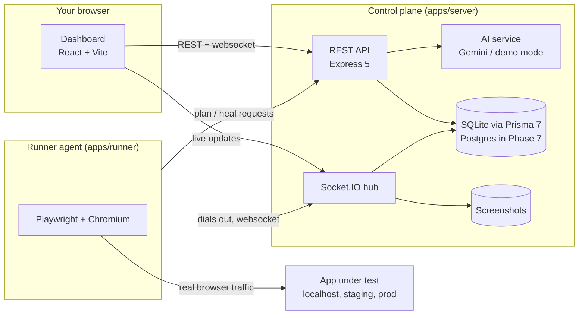

# Architecture

GhostIQ has three runtime pieces and one shared contract.

## Why a separate runner

The runner **connects out** to the control plane. That lets one dashboard drive a browser
on a developer laptop (testing `localhost`), inside a CI job (testing a preview URL) or on
a server, without opening inbound ports to the app under test.

## Packages

| Path                       | Role                                                                                                                                                         |
| -------------------------- | ------------------------------------------------------------------------------------------------------------------------------------------------------------ |
| `packages/shared`          | zod schemas for every socket event plus shared helpers. Both server and runner validate against it, so a payload change is a compile error on both sides.    |
| `apps/server`              | REST API, Socket.IO hub, persistence, AI orchestration. `createApp()` builds everything without listening, which is what the integration tests use.          |
| `apps/runner`              | CLI (`ghostiq-agent`) that registers with the server and executes runs in Chromium.                                                                          |
| `apps/dashboard`           | React UI. Uses relative URLs; Vite proxies them in dev and the server serves the built files in production, so there is one origin and no URL configuration. |
| `examples/mock-target-app` | Demo target with deliberately seeded bugs; becomes the benchmark app in Phase 4.                                                                             |

## Run lifecycle (current protocol)

1. Dashboard `POST /api/sessions` → server creates a `TestSession` and emits `run-test` to the project's runner.
2. Runner opens a fresh browser, navigates, and loops: snapshot DOM → `POST /api/ai/plan-step` → act → collect network, console and a11y → emit `step-completed` with a screenshot.
3. Server validates each event, stores the step, network calls and endpoint health, then forwards a `session-update:<id>` event to dashboards.
4. Runner emits `session-completed`; the server computes the flakiness score and, for failures, asks the AI service for a diagnostic report.

Phase 2 replaces step 2 with the agent core (Playwright `ariaSnapshot({ mode: 'ai' })` refs, a closed action schema, budgets and guardrails) and introduces the namespaced protocol (`run:start`, `step:event`, `finding:raw`, `heal:proposed`, `run:finished`, `run:cancel`).

## Configuration

All configuration is environment variables, validated at startup by `apps/server/src/env.ts`.
See `apps/server/.env.example` and `apps/runner/.env.example`. No model ID is hard-coded.

## Known limitations (tracked in `docs/PLAN.md`)

- No authentication yet: anyone who can reach the server can drive a runner (Phase 7).
- Events are broadcast to every dashboard (Phase 7: per-project rooms).
- The runner stops a run at the first failing step instead of recording a finding and continuing (Phase 2).
- Without an LLM key, planning comes from a scripted demo engine, labelled `[demo]` everywhere (Phase 1 adds real providers and a deterministic test double).
