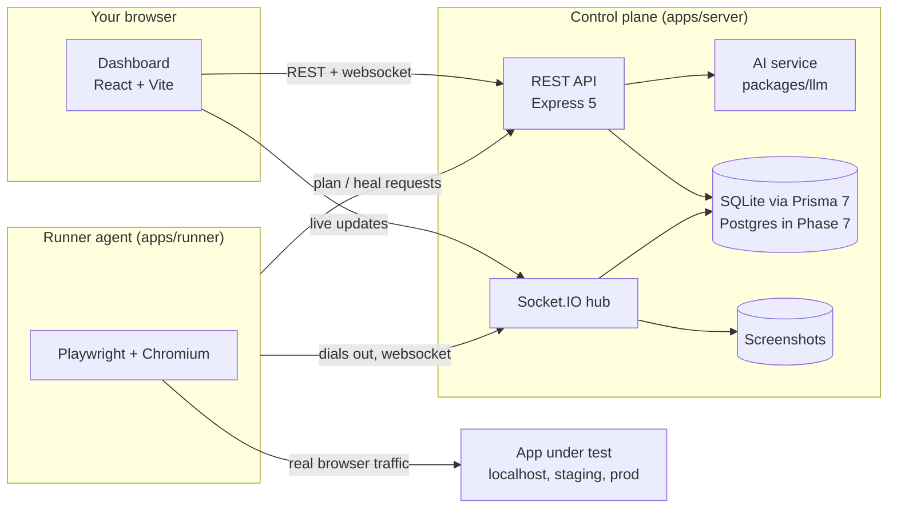
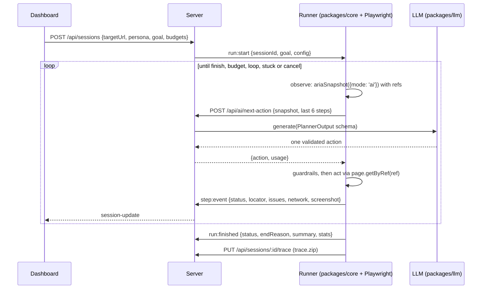

# Architecture

GhostIQ has three runtime pieces and one shared contract.

## Why a separate runner

The runner **connects out** to the control plane. That lets one dashboard drive a browser
on a developer laptop (testing `localhost`), inside a CI job (testing a preview URL) or on
a server, without opening inbound ports to the app under test.

## Packages

| Path                       | Role                                                                                                                                                                                                                                                  |
| -------------------------- | ----------------------------------------------------------------------------------------------------------------------------------------------------------------------------------------------------------------------------------------------------- |
| `packages/core`            | Agent loop: observe, plan, act, record. Budgets, loop detection, guardrails and secret masking against a `BrowserDriver`/`Planner` interface. No browser or network dependency.                                                                       |
| `packages/personas`        | Persona specs as data: YAML loader with line-numbered errors, the 8 built-in personas, seeded RNG, input generators (valid/boundary/naughty/unicode/empty/mixed), behavior injection, device and network profiles. See `docs/PERSONAS.md`.            |
| `packages/llm`             | Provider-agnostic LLM client. Thin adapters (Gemini, Claude, OpenAI-compatible/Ollama, mock) behind one core that owns schema validation + one repair retry, backoff retries, timeouts, the fallback chain, caching, cost metering and record/replay. |
| `packages/shared`          | zod schemas for every socket event plus shared helpers. Both server and runner validate against it, so a payload change is a compile error on both sides.                                                                                             |
| `apps/server`              | REST API, Socket.IO hub, persistence, AI orchestration. `createApp()` builds everything without listening, which is what the integration tests use.                                                                                                   |
| `apps/runner`              | CLI (`ghostiq-agent`) that registers with the server and executes runs in Chromium.                                                                                                                                                                   |
| `apps/dashboard`           | React UI. Uses relative URLs; Vite proxies them in dev and the server serves the built files in production, so there is one origin and no URL configuration.                                                                                          |
| `examples/mock-target-app` | Demo target with deliberately seeded bugs; becomes the benchmark app in Phase 4.                                                                                                                                                                      |

## Run lifecycle

The agent loop (`packages/core`) is browser-independent: it talks to a `BrowserDriver` and a
`Planner` interface, so every budget, guardrail and end condition is unit-tested without a browser.
The runner supplies the Playwright driver and an HTTP planner; the LLM and its keys stay on the server.

**Closed action set.** The model returns one flat JSON object (portable across providers and
small models) that is validated, then converted to a strict union: `click`, `fill`, `select`,
`press`, `hover`, `scroll`, `goBack`, `navigate` (same-origin path only), `wait`, `finish`.
Elements are addressed by snapshot ref, never by a model-invented selector. Each target is also
stored as a durable locator (`page.getByRole(role, { name })`) for replay and export.

**Guardrails.**

| Risk                        | Control                                                                                                                                                                            |
| --------------------------- | ---------------------------------------------------------------------------------------------------------------------------------------------------------------------------------- |
| Leaving the site under test | Origin allowlist checked before `navigate` and enforced in the browser by aborting off-site main-frame navigations; the driver returns to the last allowed page; popups are closed |
| Irreversible actions        | Clicks on elements named like delete / remove / pay / purchase / place order / cancel subscription are skipped (recorded as `destructive_blocked`) unless `allowDestructive`       |
| Prompt injection            | Snapshot is fenced as untrusted data in the prompt; output is schema-limited, so a fooled model can only choose permitted actions on allowed origins                               |
| Runaway runs                | Budgets for actions, wall time and tokens; the same page state 3 times ends the run (`loop_detected`); 3 failed actions in a row end it (`stuck`); cancel at any time              |
| Secret leakage              | Values typed into password/token/key fields are stored and streamed as `••••••`                                                                                                    |

**Bugs never stop a run.** Oracles in the runner attach raw `issues` to each step and the agent keeps going.

## Findings engine

`apps/server/src/findings`: `classify.ts` maps each raw issue to a finding type, route template and severity (pure, unit-tested); `engine.ts` fingerprints it (type + route + rule or normalized message), upserts the project's Finding (recurrence count, personas, latest evidence, repro steps of the first occurrence) and records an occurrence per run. Dismissed findings stay dismissed when they recur; fixed findings reopen as regressions. When a run finishes, run-level oracles execute: slow endpoints (skipped for throttled personas) and accepted invalid input (heuristic, marked _suspected_). Visual regression compares page-arrival screenshots with the baseline run's, keyed by exact path and screenshot size. `reports.ts` renders HTML, JSON, JUnit and SARIF.

**End reasons:** `goal_met`, `goal_not_met`, `budget_steps`, `budget_time`, `budget_tokens`,
`loop_detected`, `stuck`, `planner_error`, `start_failed`, `cancelled`, `runner_error`,
`runner_disconnected`.

## Configuration

All configuration is environment variables, validated at startup by `apps/server/src/env.ts`.
See `apps/server/.env.example` and `apps/runner/.env.example`. No model ID is hard-coded.

## LLM calls

Every provider call (initial, retry, repair or cache hit) is written to the `LlmCall` table with provider, model, tokens, latency, estimated cost and outcome. `GET /api/llm/status` aggregates spend (all time and last 24 h) and `GET /api/sessions/:id` includes `llmUsage` for the run. At boot the server makes one tiny real call; a retired model or bad key prints an actionable message (and exits when `GHOSTIQ_LLM_STRICT=true`).

## Known limitations (tracked in `docs/PLAN.md`)

- No authentication yet: anyone who can reach the server can drive a runner or call the planner (Phase 7).
- Bugs are recorded per step but not yet deduplicated or ranked (Phase 4: Findings).
- Login is via `--storage-state` only (no scripted login prelude yet).
- With a real model the planner is not deterministic, so only inputs, pacing and behavior rolls are seed-reproducible; Phase 5 replay removes the model.
- Events are broadcast to every dashboard (Phase 7: per-project rooms).
- Without an LLM key, planning comes from the scripted demo responder (a mock provider), labelled `[demo]` everywhere. It exercises the same LLM pipeline as a real model.
